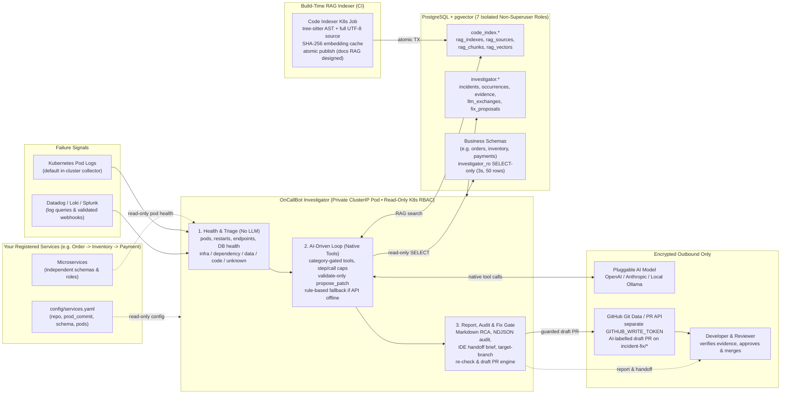

# OnCallBot

**Evidence-driven incident investigation for Kubernetes—from production signals to verified root-cause reports and human-reviewed draft pull requests.**

OnCallBot is a standalone, least-privilege Kubernetes service that investigates failures across any microservices registered in `config/services.yaml`. It pairs **deterministic health triage**, **commit-pinned AST code RAG**, **direct native LLM tool-calling** (OpenAI, Anthropic, or private local Ollama), and **strict database/cluster guardrails**—so an AI model can drive multi-step root-cause analysis without ever receiving unguarded write access to your cluster, business databases, or GitHub.

> **Interactive Explorer:** Open [docs/architecture.html](docs/architecture.html) locally in any browser for an interactive component map, source references, and build-time RAG walkthrough (no server required).

---

## System Architecture

OnCallBot separates **build-time code indexing** from **runtime investigation**, keeping business data, investigation audit records, and the vector code index isolated across **7 non-superuser PostgreSQL roles**.



---

## Core Engineering Guardrails

- **Deterministic triage before calling AI:** Captures pod health, container restarts, ready endpoints, recent K8s events, and PostgreSQL activity—recording any check gap explicitly—and classifies each incident into `infra`, `dependency`, `data`, `code`, or `unknown`. `infra` and `dependency` incidents are capped at **3 LLM steps** and do not read application code.
- **Commit-pinned AST RAG (with planned docs repo support):** Parses Java source by class, method, constructor, and field (`tree-sitter`) at build time, storing full UTF-8 files alongside chunks so every citation points to an exact `file:line` range at `prod_commit`. Publishes atomically in one PostgreSQL transaction; uses `pgvector` cosine search when embeddings are enabled and falls back cleanly to weighted keyword search. See [docs/rag.md](docs/rag.md) for the planned versioned documentation/runbook RAG contract.
- **Direct native tool-calling (no opaque agent framework):** Implements a bounded tool-calling loop directly against OpenAI-compatible (OpenAI, local Ollama) and Anthropic APIs with hard step, tool-call, and timeout budgets. If the model API is offline or disabled (`LLM_PROVIDER=none`), a deterministic fallback still saves the health snapshot, trace logs, and baseline summary.
- **Defense-in-depth data & cluster boundaries:** Business SQL tools connect exclusively through `investigator_ro` (fail-closed if `RO_PASSWORD` is missing), enforcing a single `SELECT` statement, `3s` timeout, and `50`-row cap, with every result stamped as **current observed state**. Workloads run as non-root `ClusterIP` pods with read-only root filesystems, dropped capabilities, and read-only namespace RBAC.
- **Human-in-the-loop remediation:** The LLM has zero GitHub write access—it can only call validate-only `propose_patch` (exact single-match edit at `prod_commit`, path inside service, size/edit caps, secret-pattern check). When draft PRs are opted in (`FIX_PR_ENABLED=true`), the investigator re-verifies edits against `pr_target_branch` (refusing with `409` on drift) using a separate `GITHUB_WRITE_TOKEN` and opens one AI-labelled draft PR per service. Nothing auto-merges or deploys. See [docs/draft-fixes.md](docs/draft-fixes.md).

---

## Quick Start (Local Kubernetes)

The repository includes an example three-service Spring Boot e-commerce stack (`order-service` → `inventory-service` → `payment-service`) plus a private ground-truth fault catalog (`chaos/faults.yaml`) so you can run realistic multi-service failures end to end locally.

### Prerequisites

- Docker Desktop with a **2-node Kubernetes cluster** named `desktop-control-plane` and `desktop-worker`
- `kubectl`, Windows PowerShell, and Python 3.12

### 1. Select cluster & optionally configure `.env`

```powershell
kubectl config use-context docker-desktop
```

Copy `.env.example` to git-ignored `.env` if you want to connect an LLM (`openai`, `anthropic`, or local `ollama`), embeddings, a log vendor, or GitHub draft PRs. Leave `.env` absent to run in rule-based mode only. **Never put database passwords in `.env`**—`up.ps1` generates and stores them in Kubernetes Secret `postgres-secret`.

### 2. Deploy PostgreSQL, 7 DB roles & example microservices

```powershell
.\scripts\up.ps1
```

Validates manifests, loads `.env` into `app-secrets`, generates DB credentials, labels the 2 nodes, deploys PostgreSQL + `pgvector`, provisions all **7 non-superuser schema-scoped roles**, builds and deploys the 3 example Spring Boot services, and runs security checks. It intentionally holds back the investigator until code indexes are ready. *(Pass `-StrictIsolation` to fail on unverified CNI enforcement.)*

### 3. Build & run the commit-scoped code indexer

```powershell
pip install -r indexer/requirements.txt
.\scripts\index-code.ps1
```

Generates a verified source-hash manifest on the host, bakes it into the indexer image (no host mounts), runs the `code-indexer` Job, parses AST chunks + full source, computes optional embeddings, and atomically publishes ready indexes into `code_index.*`.

### 4. Start the Investigator

```powershell
.\scripts\start-investigator.ps1
```

Verifies PostgreSQL RAG tables exist and every registered service commit has a ready index—refusing to start otherwise—then deploys `deployment/investigator` and checks `index_status()` from inside the running pod.

### 5. Open localhost-only port-forwards

Keep these running in separate windows (always bound to localhost; never `--address 0.0.0.0`):

```powershell
Start-Process kubectl -ArgumentList 'port-forward -n incident-lab svc/order-service 18080:8080'
Start-Process kubectl -ArgumentList 'port-forward -n incident-lab svc/inventory-service 18081:8080'
Start-Process kubectl -ArgumentList 'port-forward -n incident-lab svc/payment-service 18082:8080'
Start-Process kubectl -ArgumentList 'port-forward -n incident-lab svc/investigator 18090:8080'
curl.exe http://localhost:18090/health
```

### 6. Trigger a real fault scenario

```powershell
pip install -r chaos/requirements.txt
.\scripts\trigger.ps1 -Fault null-legacy
```

Enables the fault, sends a real `POST /orders` request across the services, and cleans up after the configured window. Other built-in faults in [chaos/faults.yaml](chaos/faults.yaml): `retry-dup-payment`, `status-enum`, `schema-drift`, `health-down`, and `slow-endpoint`.

- **Opt-in JPA faults:** `jpa-lazy` and `jpa-optimistic-lock` (default-disabled; see [services/inventory-service/JPA-FAULTS.md](services/inventory-service/JPA-FAULTS.md)).
- **Opt-in infra chaos:** scale-zero, pod deletion, bounded OOM, and simulated node unavailability via `.\scripts\start-infra-chaos.ps1` (see [docs/infra-chaos.md](docs/infra-chaos.md)).

### 7. Inspect the report, audit trail & IDE handoff

```powershell
curl.exe http://localhost:18090/incidents
curl.exe http://localhost:18090/incidents/<id>/report
curl.exe http://localhost:18090/incidents/<id>/audit
.\scripts\incident-handoff.ps1 -IncidentId <id>
```

`incident-handoff.ps1` saves `logs/incident-<id>-handoff.md` and copies the evidence brief to your clipboard for Copilot/IDE continuation. For read-only database browsing in DBeaver, run `.\scripts\dbeaver-connect.ps1`.

### 8. Optional — Enable Real GitHub Draft Pull Requests

The default registry uses synthetic `prod_commit: local-demo`, which the PR engine intentionally refuses. To open real AI-labelled draft PRs against `main`:

1. Commit and push all changes cleanly so `HEAD` matches `origin/main`.
2. Run `.\scripts\use-pushed-commit.ps1` to write the real 40-character SHA into git-ignored `config/services.deployed.yaml` (`-Revert` returns to `local-demo`).
3. In `.env`, set `FIX_PR_ENABLED=true`, `FIX_PR_MODE=auto` (or `approve`), a separate fine-grained `GITHUB_WRITE_TOKEN` (scoped to `vigneshreddi/oncallbot` with Contents + Pull requests read/write), and an HTTPS `FIX_EVIDENCE_BASE_URL`.
4. Re-run `.\scripts\up.ps1`, `.\scripts\index-code.ps1`, and `.\scripts\start-investigator.ps1`.

---

## Configuration & Credentials

**Nothing in this repository contains credentials, and nothing you add may either.** The static gate (`.\scripts\security-check.ps1 -Static`) fails if `.env` is ever tracked.

| Key | Purpose | Required |
|---|---|---|
| `LLM_PROVIDER` / `LLM_MODEL` / `LLM_API_KEY` / `LLM_BASE_URL` | LLM for the investigation loop (`openai`, `anthropic`, `ollama`, or `none`) | optional |
| `EMBEDDING_PROVIDER` / `EMBEDDING_MODEL` / `EMBEDDING_API_KEY` / `EMBEDDING_BASE_URL` | Embeddings for build-time vector code RAG (`openai`, `ollama`, or `none`) | optional |
| `GITHUB_TOKEN` | Read-only token for fetching a file at `prod_commit` if absent from the index | optional |
| `FIX_PR_ENABLED` / `FIX_PR_MODE` | Opt-in draft PR creation (`true` to enable; mode `auto` or `approve`) | optional |
| `GITHUB_WRITE_TOKEN` / `FIX_EVIDENCE_BASE_URL` | Separate fine-grained repo write token and HTTPS evidence link base URL | required for draft PRs |
| `LOG_PROVIDER` | Active log backend: `kubernetes` (default), `datadog`, `loki`, or `splunk` | optional |
| `DATADOG_SITE` / `DATADOG_API_KEY` / `DATADOG_APP_KEY` | Allowlisted Datadog domain and read-only log keys | for `datadog` |
| `LOKI_BASE_URL` / `LOKI_USERNAME` & `LOKI_PASSWORD` or `LOKI_TOKEN` | Loki HTTPS endpoint and basic auth **or** bearer token (not both) | for `loki` |
| `SPLUNK_BASE_URL` / `SPLUNK_TOKEN` / `SPLUNK_INDEX` | Splunk HTTPS management endpoint and read-only search token | for `splunk` |

---

## Investigator API

All 15 routes run on the private `ClusterIP` service (`http://localhost:18090` when port-forwarded).

### Read Investigation & Evidence

| Endpoint | Description |
|---|---|
| `GET /health` | Service status, registered services, active LLM/log provider, and code-index readiness per commit |
| `GET /incidents` | Lists incidents (newest first) with service, category, status, timestamps, occurrence count, usage, and failure |
| `GET /incidents/{id}/report` | Full Markdown root-cause report (deterministic snapshot, findings, draft PR links, evidence trail, usage) |
| `GET /incidents/{id}/occurrences` | Every repeat occurrence with source, alert ID, pod, `trace_id`, `span_id`, `correlation_id`, and `request_id` |
| `GET /incidents/{id}/handoff` | Self-contained Markdown brief from saved evidence for continuing in an IDE assistant |
| `GET /incidents/{id}/audit` | Chronological NDJSON audit log of every prompt, tool call/result, retrieved code chunk, and fix proposal |
| `GET /logs` | Queries the active log provider (`kubernetes`, `datadog`, `loki`, or `splunk`) by service, text, limit (max 200), and time window |
| `GET /incidents/{id}/fix` | Stored AI fix proposals, edits, status (`proposed`, `pr_opened`, `pr_failed`), and draft PR URLs |

### Ingest Alerts & Manage Draft Fixes

| Endpoint | Description |
|---|---|
| `POST /webhooks/incident` | Generic alert trigger for any registered service; opens/joins an incident and queues investigation |
| `POST /webhooks/datadog` | Validates Datadog monitor webhook (strict schema + single service tag), deduplicates, and investigates |
| `POST /webhooks/loki` | Accepts up to 20 Alertmanager-style alerts, deduplicates by event identity, and investigates each |
| `POST /webhooks/splunk` | Validates Splunk saved-search webhook matching a registered service, deduplicates, and investigates |
| `POST /incidents/{id}/propose-fix` | Human-submitted fix path after analysis (requires `reviewer_confirmed: true`, deployed SHA, and expected blob SHAs) |
| `POST /incidents/{id}/open-pr` | Approves stored AI proposals (in `approve` mode or retries) to re-verify against target branch and open draft PRs |
| `POST /incidents/{id}/reinvestigate` | Clears previous evidence, LLM exchanges, and unopened proposals, then re-queues investigation (`202 Accepted`) |

All webhook and fix endpoints reject unknown JSON fields, validate services against `config/services.yaml`, and never fetch untrusted callback URLs (`generatorURL`, `externalURL`, `results_link`). Outbound HTTP always enforces TLS verification with redirects and environment proxies disabled.

---

## Security Model & Supply Chain

- **Kubernetes workload hardening:** `ClusterIP` Services only—no Ingress, external IPs, host networking, host ports, host mounts, or privileged containers. Pods run with fixed non-root UIDs, `RuntimeDefault` seccomp, `allowPrivilegeEscalation: false`, `capabilities.drop: [ALL]`, and read-only root filesystems. The runtime gate checks live pods (including init/ephemeral containers).
- **Database role isolation:** Seven non-superuser PostgreSQL roles separate service writes (`orders`, `inventory`, `payments`), indexing (`indexer_app`), investigation state (`investigator_app`), read-only business queries (`investigator_ro`), chaos (`chaos_app`), and DBeaver browsing (`db_viewer`).
- **NetworkPolicy caveat:** Local Docker Desktop Kubernetes runs `kindnet`, which does not enforce `NetworkPolicy` manifests. Production clusters (e.g. EKS with Calico or Cilium) must supply fresh, independently collected isolation probes via `./scripts/security-check.ps1 -EnforcementEvidence <file>` (see [docs/network-isolation.md](docs/network-isolation.md)).
- **CI security workflow:** [.github/workflows/security.yml](.github/workflows/security.yml) uses SHA-pinned Actions, read-only permissions, and checksum-verified tools to run `gitleaks` (current files + full Git history), `pip-audit`, Maven Dependency-Check (`CVSS >= 7` fails), CycloneDX SBOM generation, and Trivy image scans (`HIGH`/`CRITICAL` fail). Configure branch protection on `main` to require `Security / security-gate`.

---

## Testing & Provider Acceptance

```powershell
# Static repository & manifest security checks
.\scripts\security-check.ps1 -Static
.\tests\security\test-security.ps1
.\tests\security\test-ci.ps1

# Unit & regression tests (offline, no provider credentials required)
python -m pytest -q
python -m unittest discover -s investigator/tests -p 'test_vendor*.py' -v
python -m unittest discover -s investigator/tests -p 'test_fixes.py' -v
python -m unittest discover -s tests -p 'test_rag.py' -v
python -m tests.rag_compare

# Offline provider config check (no network calls)
python scripts/live-acceptance.py --check-only
```

Billed live provider checks require explicit opt-in flags (`--enable llm`, `--enable embeddings`, `--enable datadog|loki|splunk`, `--enable github --github-repo owner/repo`, `--enable rag`) and write redacted reports only under git-ignored `tmp/`.

---

## Repository Layout

- `investigator/` — FastAPI service (`api.py`), deterministic triage (`triage.py`), native LLM client (`llm.py`), bounded tools (`tools.py`), agent loop (`agent.py`), commit-pinned RAG retrieval (`retrieval.py`), guarded draft PR engine (`fixes.py`), log collectors & vendor adapters (`sources.py`, `vendors.py`, `webhooks.py`), PostgreSQL store (`store.py`)
- `indexer/` — Build-time `tree-sitter` Java AST chunker + optional embeddings publishing atomically to `code_index.rag_*`
- `services/order-service`, `services/inventory-service`, `services/payment-service` — Example Spring Boot microservices with isolated DB schemas and fault/admin endpoints
- `services/demo-service` — Earlier single-image prototype (not deployed by `scripts/up.ps1`)
- `chaos/` — Private ground-truth fault catalogs (`faults.yaml`, `inventory-faults.yaml`) and runners (`chaos_runner.py`, `infra_runner.py`)
- `config/services.yaml` — Service registry (`repo_url`, `repo_path`, `pr_target_branch`, `prod_commit`, `db_schema`, `pod_selector`)
- `deploy/k8s/` — Kubernetes manifests (`postgres`, `services`, `investigator`, `indexer-job`, `network-policy`, `chaos`, `infra-chaos-rbac`)
- `scripts/` — Deployment (`up.ps1`), indexing (`index-code.ps1`), startup gate (`start-investigator.ps1`), fault trigger (`trigger.ps1`), commit switching (`use-pushed-commit.ps1`), IDE handoff (`incident-handoff.ps1`), DBeaver (`dbeaver-connect.ps1`), security & network probes (`security-check.ps1`, `probe-network.ps1`), provider acceptance (`live-acceptance.py`)
- `api/postman/` — Generated Postman collections and environments for service and JPA fault endpoints
- `docs/` — [architecture.html](docs/architecture.html), [rag.md](docs/rag.md), [draft-fixes.md](docs/draft-fixes.md), [network-isolation.md](docs/network-isolation.md), [infra-chaos.md](docs/infra-chaos.md), [plan-incident-investigator-monorepo.md](docs/plan-incident-investigator-monorepo.md)

---

## Known Gaps & Next Phase

- **Policy-enforcing CNI:** Local Docker Desktop uses `kindnet`; target EKS/production requires Calico or Cilium with automated `-StrictIsolation` enforcement probes.
- **Authenticated webhook ingress:** Place `/webhooks/*` behind an authenticated private relay or API gateway; do not expose publicly.
- **Cluster & trace depth:** Add read-only `apps/deployments`, `nodes`, and `metrics-server` visibility, propagate `trace_id` end-to-end across service logs, and deduplicate snapshot storage inside reports.
- **Documentation & runbook RAG (designed):** Implement the versioned documentation repository indexing pipeline alongside code RAG in `code_index` (contract documented in [docs/rag.md](docs/rag.md)).
- **Multi-model eval scorecard & PR confidence gate (planned):** Turn the private fault catalog (`chaos/faults.yaml`) and NDJSON audit trails into repeatable multi-model benchmarks (triage accuracy, citation grounding, abstention, cost/incident) and add a sandboxed compile/test verification gate to rate PR confidence.
